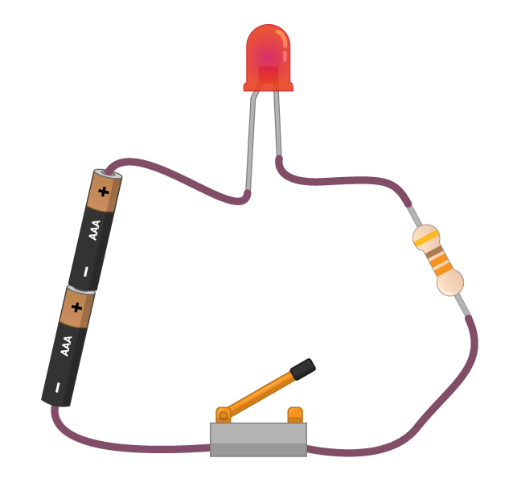

Obrázek níže ukazuje velmi jednoduchý obvod. Existují čtyři komponenty, všechny spojené pomocí vodičů.

1. Článek (nebo baterie) poskytuje obvodu energii ve formě elektřiny. Článek má pozitivní a negativní pól. Elektrická energie (nebo proud) teče od kladného pólu k zápornému pólu článku. Namísto použití buňky můžete do tohoto obvodu dodávat energii pomocí běžícího Raspberry Pi!

1. **L**ight - **E**mitting **D**iode (LED) neboli doslova světlo vyzařovující dioda je typ výstupní komponenty. Když proud protéká LEDkou, vyzařuje světlo. Různé LED diody mohou produkovat různé barvy světla a některé dokonce mohou produkovat více barev.

1. Odpor pomáhá chránit součástku LED. Odpory spotřebovávají část energie z článku, a proto snižují množství energie, která dosáhne do LED diody. Bez odporu by mohla LEDka vyhořet, stejně jako pojistka v jednom z vašich domácích spotřebičů.

1. Spínač funguje jako přerušovač obvodu. Je-li spínač otevřený, nemůže LEDkou a odporem protékat žádný proud. Když je spínač sepnutý, obvod je kompletní a proud může protékat, což způsobuje rozsvícení LEDky.
